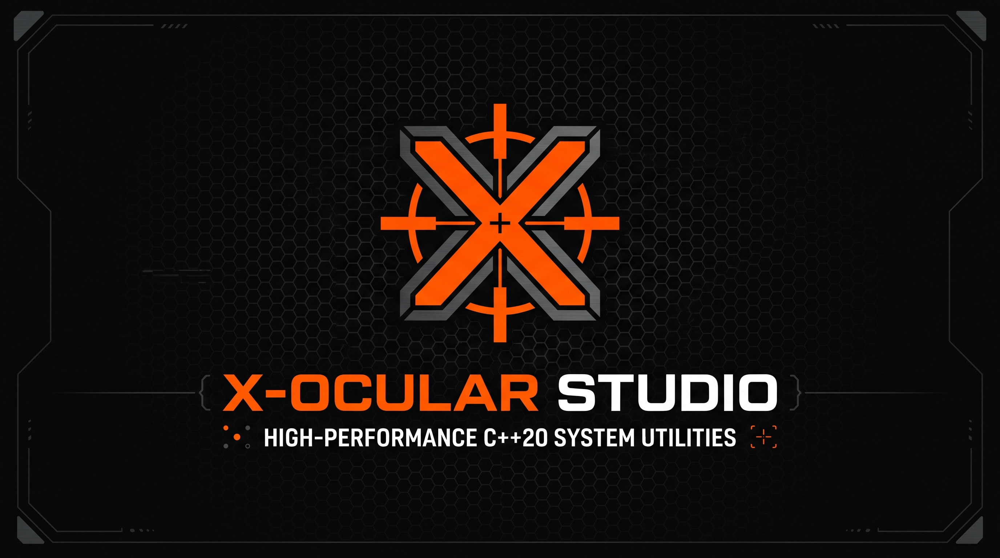

  

<h1>X-APEX BOOTSTRAPPER</h1>

**High-performance C++20 Roblox Bootstrapper & Performance Suite featuring a native Win32 Overlay HUD, System Game Booster, Live Server Browser, FastFlags Engine, and Client Mods by X-Ocular Studio.**

-FF6B00?style=for-the-badge&logo=windows&logoColor=white)

---

## // OVERVIEW

**X-Apex Bootstrapper** is a native **C++20 / Win32** alternative Roblox launcher and system performance suite engineered by **X-Ocular Studio** for maximum efficiency, zero background bloat, and clean client customization. Powered by a low-level C++ backend and a hardware-accelerated **WebView2** interface, X-Apex delivers full control over your client settings while maintaining **0% idle CPU usage** and a minimal memory footprint.

---

## // CORE FEATURES

- **🚀 X-Apex Game Booster & System Optimizer:**
  * **Auto Process Priority:** Elevates `RobloxPlayerBeta.exe` CPU scheduling priority and manages Windows 11 EcoQoS power throttling states (`PROCESS_POWER_THROTTLING_EXECUTION_SPEED`) for smoother frame pacing.
  * **Smart CPU Affinity & 1ms Timer:** Optionally configures CPU core affinity to reduce OS interrupt micro-stutters and locks 1ms multimedia timer resolution (`timeBeginPeriod(1)`).
  * **Working Set RAM Cleaner:** One-click and automatic pre-launch memory optimization (`EmptyWorkingSet`) with live CPU & RAM telemetry.
- **🎯 Native Win32 In-Game Overlay HUD (`Insert` Hotkey):**
  * Toggle a translucent Always-on-Top Win32 HUD directly over your window without pressing `Alt + Tab`.
  * View real-time CPU load, system RAM, process memory usage, active Place ID, and server region.
  * Execute instant in-game actions: **Smart Hop**, **Rejoin Server**, and **Purge RAM**.
- **🌐 Smart Server Hop & Live Server Browser:**
  * Query public server instances via the official Roblox Games API with live player counts (`Players / Max`), server ping (`ms`), and server FPS.
  * Choose intelligent hop modes: **Smallest Server** (ideal for solo grinding), **Best Ping**, **Largest Server**, or **Random Server** (guaranteed to skip your current `JobId`).
- **⚡ FastFlags Engine & Profile Presets:**
  * Apply one-click performance presets (*Ultra FPS Potato*, *Competitive Low Latency*, *High Quality Lighting*) or customize rendering APIs (Direct3D 11 / Vulkan), lighting technologies, and MSAA.
  * Edit `ClientAppSettings.json` directly via the built-in **Table Editor** or **Raw JSON Code** view with multi-profile management.
- **🛠️ Global Settings Control:**
  * Modify `GlobalBasicSettings_13.xml` (custom framerate target, fullscreen mode, master volume, mouse sensitivity) without launching the game, with an option to lock files as **Read-Only**.
- **🎨 Client Mods & Overrides:**
  * Easily apply custom game fonts (`.ttf`/`.otf`), custom death sounds (*Classic Oof* or custom audio), custom mouse cursors, and custom Shift Lock icons.
- **🎮 Discord Rich Presence & Session Tracking:**
  * Automatically displays your active Roblox experience, cover art, server details, and elapsed session time on your Discord profile.
- **📦 Advanced Bootstrapper & Deployment:**
  * Multi-instance Roblox session support (`ROBLOX_singletonMutex` management).
  * Automatic background termination of `RobloxCrashHandler.exe` to free system resources.
  * Multi-language UI localization (**English**, **Serbian**, **German**), full JSON configuration Export / Import, and a native borderless Win32 Splash Screen.

---

## // INSTALLATION & UPDATING

1. Navigate to the **[Releases](../../releases)** section on the right side of this repository.
2. Download the latest **`X-Apex_Installer_v0.3.0.exe`** package from the **Assets** section.
3. Run the installer and follow the setup wizard (existing installations are automatically updated while preserving all your profiles, FastFlags, and mods).
4. *(Note)* Because X-Apex is a newly compiled native binary, Windows SmartScreen may display an *"Unknown Publisher"* prompt on first launch — click **More info → Run anyway**.

---

## // SUPPORT & BUG REPORTS

Found a bug or need help configuring your setup?
- Open X-Apex and go to **Settings / Bootstrapper → Open Logs** to grab your diagnostic log file.
- Open an issue in the **[Issues](../../issues)** tab or join our official **X-Ocular Studio Discord Server** for direct support.

---

## // LEGAL & COPYRIGHT

© 2026 **X-Ocular Studio**. All Rights Reserved.  
This software is proprietary (closed-source). Unauthorized reproduction, redistribution, reverse engineering, or modification of this binary or any associated assets is strictly prohibited without prior written permission from **X-Ocular Studio**.
