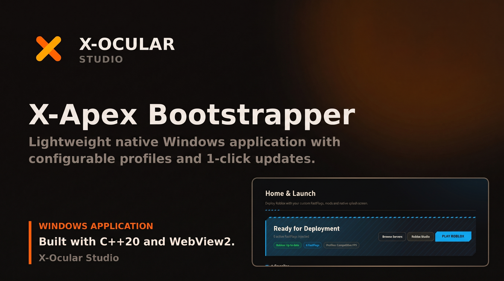

  

<h1>X-APEX BOOTSTRAPPER</h1>

**A proprietary Windows launcher and configuration utility for Roblox, developed by X-Ocular Studio.**

-FF6B00?style=for-the-badge&logo=windows&logoColor=white)

---

## Overview

X-Apex Bootstrapper is a native Windows desktop application built with C++20, the Win32 API, and Microsoft Edge WebView2. It provides launch, local configuration, and system telemetry features for Roblox sessions.

X-Apex Bootstrapper is an independent third-party project. It is not affiliated with, endorsed by, or officially supported by Roblox Corporation. Roblox does not officially support third-party launchers or tools that modify local client files or processes. Users are responsible for reviewing applicable platform terms and deciding whether to use these features.

## Features

### Local configuration and profiles

- View and edit local `ClientAppSettings.json` profiles using a table editor or raw JSON editor.
- Use optional presets for rendering and graphics settings, including API selection, lighting modes, and MSAA.
- Edit selected values in `GlobalBasicSettings_13.xml`, including framerate target, fullscreen state, audio volume, and mouse sensitivity.
- Optionally set edited configuration files to read-only.
- Export and import application configuration in JSON format.

### Local client asset customization

- Replace selected local client assets, including fonts (`.ttf`, `.otf`), audio files, mouse cursors, and Shift Lock icons.
- These features modify files on the local system. Back up files before making changes; client updates may overwrite them or cause compatibility issues.

### Server browsing and launching

- Display publicly available Roblox server information, including player counts and estimated latency.
- Filter or select a server using player-count or latency preferences and launch the official Roblox client for a selected `PlaceId` / `JobId`.
- Server information and availability may change, and this utility is not an official Roblox service.

### System telemetry and process options

- Display CPU usage, system memory usage, and `RobloxPlayerBeta.exe` memory consumption.
- Provide optional Windows process settings, including process scheduling priority, CPU affinity, power-throttling settings, and timer-resolution requests.
- Provide an option to terminate `RobloxCrashHandler.exe`.
- These options affect local system or process behavior. Use them only if you understand their effects; results can vary by Windows version and hardware.

### Overlay and session options

- Show a translucent, always-on-top Win32 overlay with system telemetry and launch controls. The default toggle key is `Insert`.
- Include an option to manage the `ROBLOX_singletonMutex` for launching multiple client instances. Roblox does not officially support this use; compatibility and account or platform consequences are not guaranteed.

### Other utilities

- Discord Rich Presence for displaying active game session information.
- Interface localization in English, Serbian, and German.
- A native installer and update workflow.

## Installation

1. Visit this repository's [Releases](../../releases) page.
2. Download the installer from the Assets section of the release.
3. Run the installer and follow its on-screen instructions.

Existing profiles and local configuration files are intended to be preserved during updates. Back up important files before installing or updating.

## Security and limitations

- **Unsigned installer:** The installer is not currently digitally signed with a commercial code-signing certificate. Windows SmartScreen or antivirus software may display a warning. A warning alone does not establish whether a file is safe or unsafe.
- Download the installer only from this repository's official Releases page. If you cannot verify the file's source or integrity, do not run it. Do not rely on this README as proof that a binary is safe.
- **Closed-source software:** The application source code is not published in this repository, so independent review of the distributed binary is not available here.
- **Local changes:** Some features edit local configuration or asset files, or affect running processes. Back up relevant files and review each option before use.
- **Compatibility:** Roblox, Windows, or third-party software updates may change behavior or break compatibility. No compatibility or uninterrupted operation is guaranteed.

## Support and bug reports

- In the application, open **Settings / Bootstrapper → Open Logs** to access diagnostic logs.
- Report bugs or compatibility issues in the repository's [Issues](../../issues) section. Include the app version, Windows version, steps to reproduce the issue, and relevant logs. Remove personal or sensitive information from logs before sharing them.

## License and copyright

© 2026 X-Ocular Studio. All Rights Reserved.

This software is proprietary and closed-source. No rights to copy, modify, distribute, reverse-engineer, or create derivative works from the software or its associated assets are granted without prior written permission from the rights holder.

